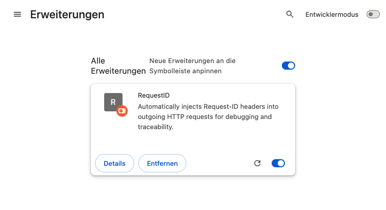
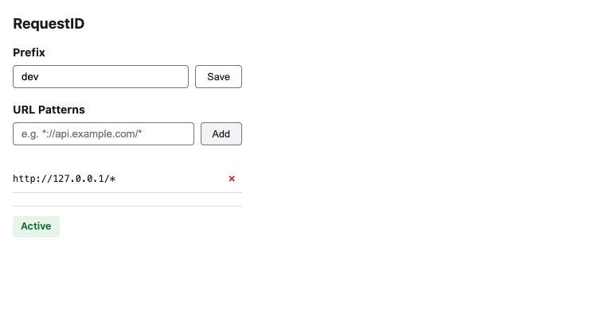
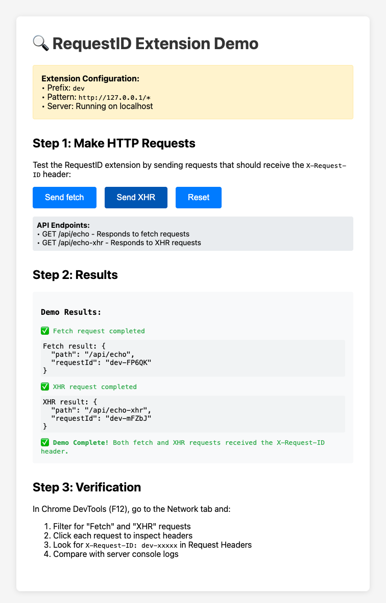

# Sample usage

End-to-end walkthrough: load the extension, configure it, send requests, and see `X-Request-ID` on the wire.

Captured with **Google Chrome for Testing 155.0.8059.39** (mac-arm64), headless, unpacked extension, isolated profile.

## 1. Load the extension

Open `chrome://extensions/`, enable **Developer mode**, click **Load unpacked**, select the repository root.



## 2. Configure prefix and pattern

Open the toolbar popup and set:

- **Prefix**: `dev`
- **Pattern**: `http://127.0.0.1/*` — exact host, no port (matching uses `URL.hostname`; see README)



## 3. Start the demo server

```bash
node examples/demo-server.mjs          # http://127.0.0.1:8712/
PORT=8713 node examples/demo-server.mjs   # other port
```

The page at `/` has **Send fetch** and **Send XHR** buttons; `/api/echo` and `/api/echo-xhr` return the received `x-request-id` as JSON.

## 4. Send requests

Open `http://127.0.0.1:8712/` and click both buttons. The page shows what the server received.



## Captured evidence

| Request | Browser request header (CDP) | Server log | Result |
| --- | --- | --- | --- |
| `GET /api/echo` (fetch) | `x-request-id: dev-FP6QK` | `dev-FP6QK` | HTTP 200 |
| `GET /api/echo-xhr` (XHR) | `x-request-id: dev-mFZbJ` | `dev-mFZbJ` | HTTP 200 |
| `GET http://localhost:8712/api/echo` (non-matching host) | no `x-request-id` | `<none>` | request sent, response blocked by CORS as expected |

Browser-side headers came from the DevTools Protocol network capture; server-side lines from the demo server's stdout. Both agree per request.

Each request gets a **fresh** ID, so fetch and XHR intentionally differ.

## 5. Verify yourself in DevTools

1. Open DevTools (`F12`) → **Network**, filter **Fetch/XHR**.
2. Click `api/echo`, open **Headers → Request Headers**, look for `X-Request-ID: dev-XXXXX`.
3. Compare with the demo server terminal output — the values must match.
4. To see the injection live, put a breakpoint on `src/injected.js` (Sources) or add `debugger;` in the page's fetch call.

## Notes

- Requests sent before the extension's config arrives have no ID (fail-open).
- Cross-origin targets need the backend to allow `X-Request-ID` in `Access-Control-Allow-Headers`, otherwise the preflight blocks the request (see the `localhost` row above).
